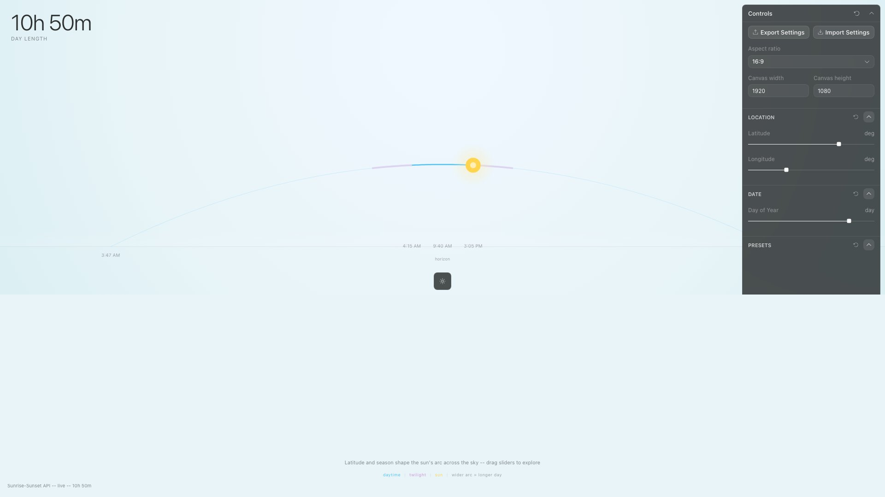

<div align="center">

<h1>Sol</h1>

<p><b>The sun's daily arc, by latitude and season.</b></p>

<p><i>Slide from the equator to the Arctic, or from June to December, and watch the day stretch and shrink.</i></p>

<h6>


</h6>

<a href="https://sol.parthchandak.info"><b>Live demo</b></a> ·
<a href="#how-it-works"><b>How it works</b></a> ·
<a href="#run-it"><b>Run it</b></a>

<br><br>

<a href="https://sol.parthchandak.info"></a>

<sub>Live capture, 22 October 2026: New York, today's date. Real API data.</sub>

</div>

<br>

A pastel Canvas 2D sky with one arc across it. Three sliders set latitude, longitude and day of
the year; the arc and the big day-length number top-left follow. Sunrise, solar noon, sunset and
civil twilight come from the free [Sunrise-Sunset API](https://sunrise-sunset.org/api), so no key
is needed. It opens on New York and today's date.

## How it works

| Input | Drives |
|---|---|
| Solar noon altitude, from latitude and the sun's declination on that day | How high the arc rises |
| Day length, from the same formula | How much of the arc is lit blue as daytime |
| API `civil_twilight_begin` / `_end` | The lavender bands either side of daytime, and the outer time labels |
| API `sunrise`, `solar_noon`, `sunset` | The time labels under the arc |
| The clock now, against that day's sunrise and sunset | Where the sun sits on the arc |

The arc is a stylised curve, not a true azimuth and elevation plot. Arc height and the daytime
share are computed in the browser; the clock times come from the API, with a computed estimate
(stamp says `computed`) if the request fails. Results are cached per location and date.

Click anywhere on the sky for a card with all six times and the day length; it fades after
three seconds. Times are shown in the viewer's own time zone.

The control panel and canvas shell come from the Toolcraft template (Pixel Point, MIT), which
also adds export/import of settings and aspect-ratio controls.

## Run it

```bash
git clone https://github.com/parthchandak02/sol.git
cd sol
npm install
npm run dev      # picks a free port, starting at 3002
npm run build    # type-check, then static site in dist/
```

The live version runs on Cloudflare Pages.

<details>
<summary><b>Project layout</b></summary>

```
src/components/SunPathCanvas.tsx  The piece: solar maths, API fetch, arc drawing
src/app/app-schema.ts             Sliders and preset buttons (Toolcraft schema)
src/routes/index.tsx              Overlays: day length, data stamp, legend, times card
src/toolcraft/                    Vendored Toolcraft runtime (do not edit)
brief.md                          The original creative brief
AGENTS.md, docs/toolcraft/        Toolcraft's rules for working in the repo
e2e/, scripts/                    Toolcraft's test and verification harness
```

</details>

<details>
<summary><b>Known rough edges</b></summary>

- The canvas draws at window size inside the 16:9 output frame, so on most screens the arc runs
  past the right edge and the overlays sit outside the frame.
- The city preset buttons (New York, London, Tokyo, Sydney, Singapore, Reykjavik, Cape Town)
  are declared in the schema, but the Presets section renders empty and nothing handles them yet.
- The sun only moves along the arc when the selected day is today; on any other day it parks at
  sunrise or sunset.

</details>

<br>

<div align="center">
<sub>Built with React, Canvas 2D, Vite and the Toolcraft template. Data from sunrise-sunset.org.</sub>
</div>
