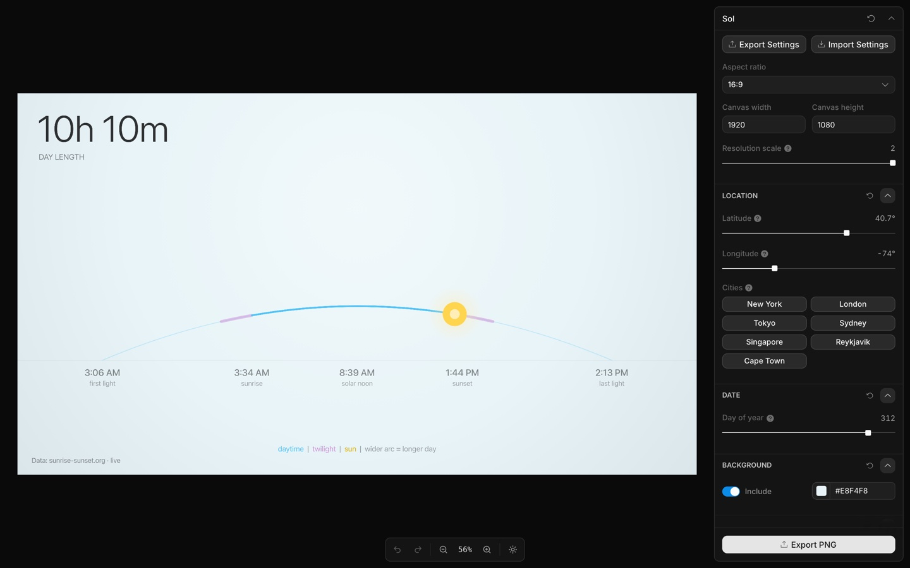

<div align="center">

<h1>Sol</h1>

<p><b>One day of sunlight, anywhere on Earth.</b></p>

<p><i>Pick a place, a day and a time, and see how high the sun climbs, when it rises and sets, and how long the light lasts.</i></p>

<h6>


</h6>

<a href="https://sol.parthchandak.info"><b>Live app</b></a> ·
<a href="#how-it-works"><b>How it works</b></a> ·
<a href="#run-it"><b>Run it</b></a>

<br><br>

<a href="https://sol.parthchandak.info"></a>

<sub>The default poster: New York on the June solstice at 17:00 local time.</sub>

</div>

<br>

Sol draws one day of sunlight as a poster. The left column names the place and its time zone,
the date, the day length in large serif numerals, and the day's key times: sunrise, sunset, solar
noon with the sun's highest elevation, the evening golden hour, civil twilight, and where the sun is
at the chosen moment. The right side plots the sun's elevation through all 24 local hours, with
civil, nautical and astronomical twilight shaded below the horizon, and a strip underneath shows
how day length changes through the year.

Drag Latitude, Longitude, Day of year and Time of day, or use the shortcuts: eight cities (New
York, London, Tokyo, Singapore, Reykjavík, Cape Town, Sydney and Tromsø for the midnight sun and
polar night), the equinoxes and solstices, and **Now** for the current moment at that place. The
background colour can be changed or left out, and the poster exports as PNG or JPG at 2K, 4K or 8K.

## How it works

The sun's position comes from the NOAA solar calculator (Meeus's algorithms), computed in the
browser, so there is no API and no network dependency. Sunrise, sunset and twilight times are found
by sampling the day every five minutes and refining each horizon crossing; they agree with NOAA's
published tables to within about a minute. City presets show times in the city's own time zone
(daylight saving included); any other place uses the nearest whole-hour offset from its longitude,
labelled as UTC±N.

The poster is drawn with Canvas 2D in a Web Worker, at the exact zoomed backing resolution, and the
same drawing function renders the exported image. The editor shell, panel, settings
import/export, saved workspace and image export come from
[Toolcraft](https://github.com/pixel-point/toolcraft) (Pixel Point, MIT).

## Run it

```bash
git clone https://github.com/parthchandak02/sol.git
cd sol
npm install
npm run dev              # local editor; needs Node 22+
npm test                 # unit tests plus Toolcraft's contract checks
npm run verify:delivery  # full functional acceptance in a real browser
```

The live version is a static build (`npm run build`, then `dist/`) on Cloudflare Pages.

<details>
<summary><b>Project layout</b></summary>

```
src/sol/solar.ts               Solar position, day events, time zones (NOAA calculator)
src/sol/sol-draw.ts            Draws the whole poster; preview and export share it
src/sol/SolCanvas.tsx          The live canvas: worker raster at the exact backing size
src/sol/sol-controls.ts        Place and Moment controls; city, season and Now shortcuts
src/app/app-schema.ts          Toolcraft schema: sections, canvas, image export
src/app/app-acceptance-data.ts What every control must visibly do (checked in a real browser)
e2e/product-sol-*.spec.ts      Browser acceptance tests, one file per area
src/toolcraft/                 Vendored Toolcraft runtime (do not edit)
```

</details>

<br>

<div align="center">
<sub>Built with Toolcraft, React and Canvas 2D. Solar math after the NOAA Solar Calculator.</sub>
</div>
